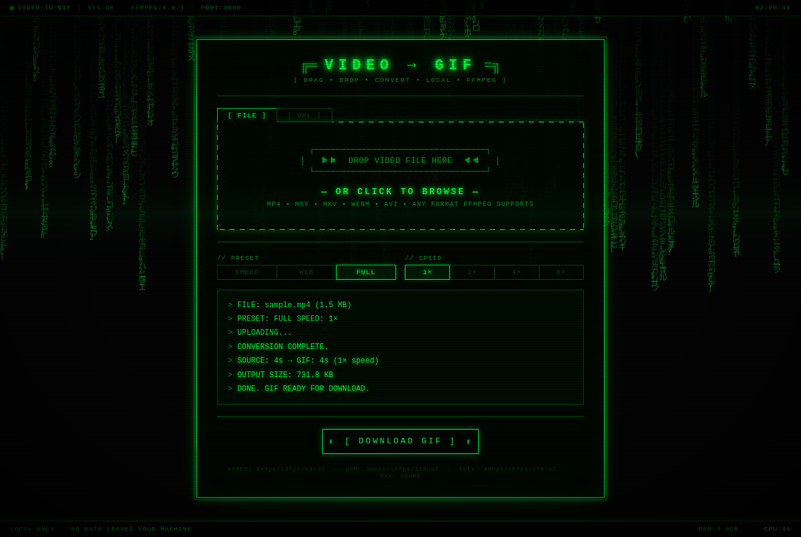
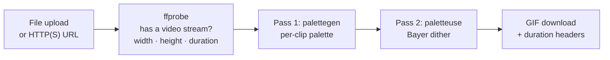

<div align="center">

# video-to-gif

[](LICENSE)

### Drop a video in, get a clean GIF out. Locally, in two passes, with no uploads to anyone.

**A single-file Flask app with a retro CRT terminal UI. Files or URLs in, palette-optimized GIFs out, everything on your own machine.**


**[Quick start](#quick-start) · [How it works](#how-it-works) · [Presets](#presets) · [HTTP API](#http-api) · [FAQ](#faq)**



</div>

---

Most "video to GIF" sites want your file on their server and hand back a muddy, dithered result. video-to-gif runs on `localhost`, reads anything ffmpeg can read (including a remote URL, streamed straight into ffmpeg), and encodes with a generated per-clip palette, so colors stay faithful at a small file size.

## Quick start

Requirements: Python 3.8+, and `ffmpeg` + `ffprobe` on your `PATH`.

```sh
git clone https://github.com/AlienWalker1995/video_to_gif
cd video_to_gif
pip install -r requirements.txt
python app.py
```

Open **http://localhost:3000**, then either:

- **File:** drag a video onto the drop zone, or click it to browse.
- **URL:** switch to the `[ URL ]` tab, paste an `http://` or `https://` link, and press Enter.

Pick a preset and a speed, and the GIF downloads straight from the page when it is ready.

## How it works



| Step | What happens |
|---|---|
| **Validate** | `ffprobe` confirms the input contains a video stream. Validation is by content, never by file extension. |
| **Scale** | Aspect ratio is always kept. Portrait clips scale on height, landscape on width, to the preset's size. |
| **Speed** | `setpts=PTS/N` plays the whole clip 1x, 2x, 4x, or 8x faster, so long recordings become short GIFs without cutting content. |
| **Encode** | Two passes: `palettegen` builds a palette from the clip itself, then `paletteuse` maps frames onto it. |
| **Clean up** | Each job runs in its own `TemporaryDirectory`, removed on success or failure. |

URL inputs are handed to ffmpeg directly, with no intermediate download step, which works for S3, CDNs, and extensionless asset links.

## Presets

| Preset | Long edge | FPS | Colors | Best for |
|---|---|---|---|---|
| `EMBED` | 240 px | 10 | 64 | Slack, email, docs: smallest file |
| `WEB` | 360 px | 15 | 128 | Web pages and READMEs |
| `FULL` | 480 px | 15 | 256 | Best quality (default) |

Uploads are capped at **500 MB**.

## HTTP API

The UI is a thin client over one endpoint, so scripts can use it too.

`POST /convert` (`multipart/form-data`)

| Field | Values | Notes |
|---|---|---|
| `video` | file | Ignored when `url` is set |
| `url` | `http://` or `https://` URL | Takes priority over `video` |
| `preset` | `embed` · `web` · `full` | Default `full` |
| `speed` | integer, 1 or more | Default `1`; the UI offers 1, 2, 4, 8 |

Success returns `image/gif` with `X-Video-Duration` (source seconds) and `X-Video-Speed` headers. Failure returns JSON `{"error": "..."}` with a 4xx or 5xx status.

```sh
curl -F video=@clip.mp4 -F preset=web -F speed=2 http://localhost:3000/convert -o clip.gif
```

## FAQ

**Does my video leave my machine?** No. Uploads go to the Flask server on `localhost` and are deleted when the job ends. URL inputs are fetched by your local ffmpeg.

**Which formats work?** Anything your ffmpeg build can decode: MP4, MOV, MKV, WEBM, AVI, FLV, and more.

**Why two passes?** GIFs hold 256 colors at most. A palette generated from the clip itself keeps far more color fidelity than a generic palette.

**Can I expose it on my network?** It is built as a local tool: `python app.py` binds `127.0.0.1` with Flask's debug server. Put it behind a production WSGI server and an authenticating proxy before sharing it.

## Project layout

```
app.py                 Flask backend: routes, ffprobe validation, two-pass ffmpeg encode
templates/index.html   the CRT terminal UI (embedded CSS + vanilla JS, no external requests)
requirements.txt       Python dependencies (Flask only)
docs/screenshot.png    README screenshot
```

## License

[MIT](LICENSE)
